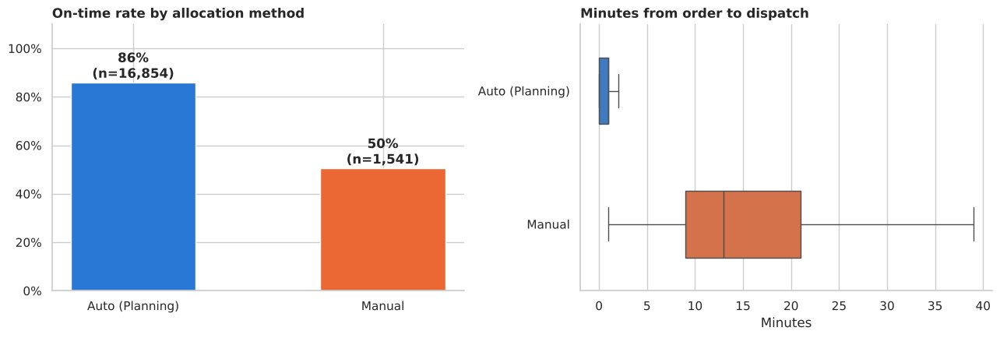
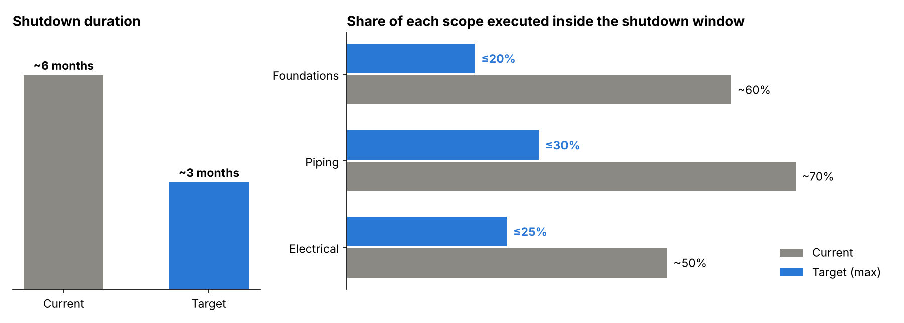

# Akshat Tripathi

**MS Engineering Management Candidate, Rice University (Dec 2026) · Project, Product & Data Strategy**

Houston, TX · [akshat.tripathi26@gmail.com](mailto:akshat.tripathi26@gmail.com) · [LinkedIn](https://linkedin.com/in/akshat-tripathi-) · (281) 779-7677

---

## Summary

Engineering Management graduate student at Rice University (graduating December 2026). I most recently led delivery of an AI-powered student coaching platform at System Innovations, and I'm the TA for Rice's Data Science for Engineering Leaders course. Before Rice I was a Senior Analyst at KPMG Advisory working with Fortune 500 clients, and I worked in go-to-market roles at LogiNext and HighRadius. Lean Six Sigma Green Belt. I'm looking for full-time roles in project management, product management, consulting, and technical management.

---

## Core Impact Metrics

| Focus Area | Result | Context |
|---|---|---|
| **Enterprise Pipeline** | **$500 million** in opportunity pipeline from targeted ABM campaigns | HighRadius |
| **Revenue** | Converted a strategic account worth **$100,000 ARR** | LogiNext |
| **Predictive Modeling** | Late-delivery classifier with **0.86 ROC-AUC** that catches **71% of late orders** | Last-mile delivery project |
| **Operational Redesign** | Lean Six Sigma plan targeting a **50% reduction** in plant shutdown duration | Rice University · Oil & Gas |

---

## Featured Projects

### Last-Mile Delivery Risk Predictor (QSR delivery, Egypt)
*Machine Learning · Logistics Operations · Python, scikit-learn* · **[Read the case study →](last-mile-delivery.html)** · [Notebook](https://github.com/akshattripathi26/akshat_tripathi.github.io/blob/main/last_mile_delivery_classification.ipynb)

* Predicted, at the moment of dispatch, whether an order would miss the 30-minute promise, using 18,395 cleaned orders from LogiNext's auto-allocation platform.
* Reframed a weak regression (R² 0.16) into a classification problem: logistic regression reached **0.86 ROC-AUC** (5-fold CV 0.855 ± 0.011) and **caught 71% of late orders**.
* Showed that auto-allocated orders were on time **86% vs 50%** for manual ones (median dispatch delay of 1 vs 13 min), and proposed risk bands plus a supervisor alert when slack drops below 5 min.

### UPS Parcel Freight Cost Analysis
*Supply Chain Analytics · Cost Engineering · Python, pandas* · **[Read the case study →](ups-freight-cost.html)** · [Notebook](https://github.com/akshattripathi26/akshat_tripathi.github.io/blob/main/ups_freight_cost_analysis.ipynb)

* Cleaned a year of shipment-level UPS invoices (70+ fields) and built 12 cost views: service mix, surcharges, zones, Pareto concentration, consolidation, and import landed cost.
* Found that **two services ≈ 95% of spend** and that **surcharges and fees ≈ 25%**, and that far zones cost **≈2.6× more per lb** than near zones.
* Turned the findings into contract levers (a fuel-surcharge cap, accessorial waivers) and operational ones (same-day consolidation, account-level agreements).

### Reducing Planned Shutdown Duration (Lean Six Sigma, Oil & Gas)
*Lean Six Sigma · DMAIC · Project Management · 4-person team* · **[Read the case study →](shutdown-lean-six-sigma.html)**

* Chartered a DMAIC project to cut planned shutdowns from **~6 to ~3 months** (target) by moving non-critical work out of the shutdown window.
* Ran fishbone root-cause analysis across six categories and designed three solution pillars: scope optimization, execution methods, and planning readiness.
* Built a control plan with owners, cadence, and stage-gate triggers: **≥75% pre-shutdown completion** before start and **≥50% less rework**.

### ScholarlE Engen: AI Student Application Coaching Platform
*AI Product Delivery · Project Management · Data Management*

* Led cross-functional delivery of an AI-powered coaching platform that helps students with scholarship applications, as part of Rice's Summer Engineering Innovation Program (SEIP).
* Held three roles: project manager, AI co-implementer, and data manager. I worked with AI engineers on data architecture and system feasibility for the conversational AI agent.
* Ran sprint planning, client communication, and technical execution across a team of engineers and consultants.

---

## Professional Experience

### Rice University | Teaching Assistant, Data Science for Engineering Leaders (RCEL 506)
*Aug 2026 – Present | Houston, TX*

* Support graduate coursework that introduces statistical computing and computational methods to engineering managers.
* Delivered the course lecture on classification and logistic regression, and lead GitHub workshops to build students' data fluency.

### System Innovations | Technical Project Lead Intern (Rice SEIP)
*May 2026 – Aug 2026 | Houston, TX*

* Directed end-to-end technical delivery of ScholarlE Engen, an AI-driven coaching platform.
* Coordinated system architecture design and data management strategy across engineering and advisory stakeholders.

### KPMG | Senior Analyst, Advisory
*Jan 2024 – Nov 2024*

* Analyzed finance, logistics, and operational workflows for Fortune 500 clients to identify digital transformation initiatives.
* Resolved high-impact client process bottlenecks through root-cause analysis, earning Employee of the Quarter and the KPMG Rising Star award.

### LogiNext | Marketing Associate
*Aug 2022 – Oct 2023*

* Led customer discovery across North and South America, qualifying enterprise accounts (BANT) to inform go-to-market positioning.
* Converted a strategic enterprise account into $100,000 ARR by aligning the SaaS solution's value with the client's decision criteria.

### HighRadius | Account-Based Marketing Intern
*May 2021 – Jul 2022*

* Mapped order-to-cash process journeys across credit, collections, and cash application functions.
* Generated $500 million in opportunity pipeline by designing targeted, account-segmented marketing campaigns.

---

## Education

### Rice University | MS, Engineering Management and Leadership
*Aug 2025 – Dec 2026 | Houston, TX*

* **Relevant coursework:** Data Science, Data Visualization, Product Management, Project Management, Lean Six Sigma, Engineering Leadership
* Rice University Merit Scholarship ($20,000)

### SRM Institute of Science and Technology | B.Tech, Electronics & Communication
*May 2018 – May 2022*

* GPA 3.87 / 4.00

### Certifications & Awards

* Lean Six Sigma Green Belt
* IBM Applied AI Certificate
* KPMG Employee of the Quarter and Rising Star Award

---

## Skills

| Category | Tools & Competencies |
|---|---|
| **Data & Analytics** | Python (pandas, NumPy, scikit-learn, matplotlib, seaborn), Jupyter / Google Colab, logistic & linear regression, data visualization, C / C++ |
| **Project & Product** | Jira, Asana, Miro, Git/GitHub, sprint planning, stakeholder management |
| **Process & Strategy** | Lean Six Sigma (DMAIC), process optimization, go-to-market strategy, BANT qualification |
| **GTM Platforms** | Salesforce, HubSpot CRM, LinkedIn Sales Navigator, Apollo.io, ZoomInfo |

---

## Contact

* **Email:** [akshat.tripathi26@gmail.com](mailto:akshat.tripathi26@gmail.com)
* **LinkedIn:** [linkedin.com/in/akshat-tripathi-](https://linkedin.com/in/akshat-tripathi-)
* **Phone:** (281) 779-7677
* **Location:** Houston, TX
