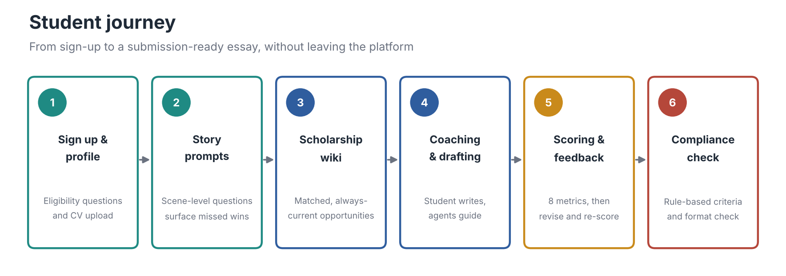
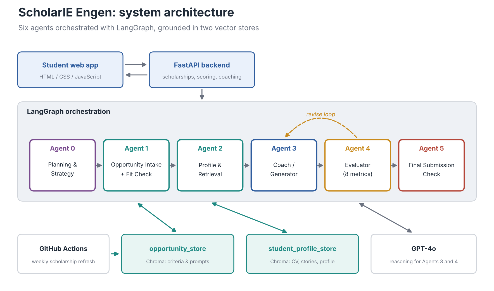
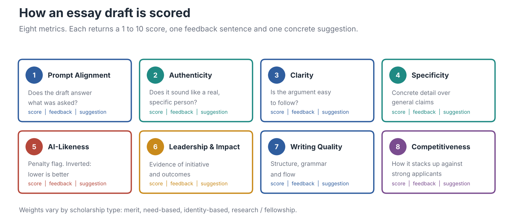
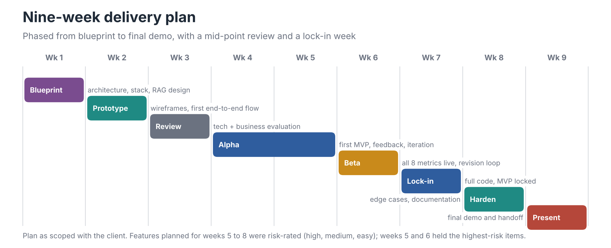

# ScholarlE Engen

**An AI scholarship coach that helps students write stronger applications in their own voice.**
Built for a System Innovations client through the Rice University SEIP program (2026).

> Coach, not ghostwriter. The platform asks questions, surfaces a student's real stories, scores drafts against a research-grounded rubric and checks compliance. The student writes every word.

---

## At a glance

| | |
|---|---|
| **Client** | System Innovations |
| **Program** | Rice University SEIP, 2026 |
| **My roles** | Technical Project Lead (project manager), AI co-implementer, Data manager |
| **Stack** | Python, LangGraph, FastAPI, Chroma, OpenAI GPT-4o, HTML / CSS / JavaScript, GitHub Actions |
| **Team** | Five people: team lead (client-facing), project / technical lead (me), AI implementation engineer, software engineer, technical support |
| **Code** | Client codebase is private. This repo holds the project overview and documentation. |

## The problem

Many students never apply for scholarships they qualify for. Scholarships are scattered across sites, eligibility rules are hard to read, and strong students with thin CVs do not know which of their experiences are worth writing about. Generic AI tools make this worse by producing polished but generic essays that readers can often spot.

## What the platform does

1. **Profile and eligibility.** About 38 questions designed to unlock eligibility (Pell status, first-generation, citizenship, county, military connection and more), split into required, optional and optional-sensitive tiers.
2. **Story prompts.** Scene-level micro-questions that pull out achievements a student would not put on a CV, structured so the answers can feed an essay later.
3. **Always-current scholarship wiki.** A weekly scheduled job discovers new scholarships, validates the links and writes them to the platform database, so students never have to leave the platform to search elsewhere.
4. **Coaching and drafting.** Agents guide the student with questions and structure, grounded in the student's own profile and the scholarship's real prompt.
5. **Scoring and feedback.** Eight metrics with a concrete suggestion for each.
6. **Compliance check.** A rule-based agent checks word count, format, required documents and eligibility criteria and tells the student what to fix before submitting.

## Architecture

| Agent | Responsibility |
|---|---|
| 0 Planning and Strategy | Plans the application workflow |
| 1 Opportunity Intake + Fit Check | Reads the scholarship and checks the student fits |
| 2 Profile and Retrieval | Pulls relevant facts and stories from the student's profile |
| 3 Coach / Generator | Guides the student and drafts structure and questions |
| 4 Evaluator | Scores the draft on eight metrics |
| 5 Final Submission Check | Rule-based compliance check |

Two Chroma vector stores keep the student's data (`student_profile_store`) separate from scholarship data (`opportunity_store`).

## Scoring rubric

Each metric returns a 1 to 10 score, a feedback sentence and one suggestion. Weights change by scholarship type (merit, need-based, identity-based, research or fellowship). AI-Likeness is treated as a penalty flag, where lower is better.

### Research grounding

| Paper | Why it mattered |
|---|---|
| [arXiv 2503.20062](https://arxiv.org/abs/2503.20062) (Cornell) | LLM and human essays are easy to tell apart, and LLMs over-use prompt keywords. This informed the Authenticity and AI-Likeness metrics. |
| [arXiv 2510.09030](https://arxiv.org/abs/2510.09030) (U Tokyo) | Iterative rubric refinement improved agreement with human graders. This informed how the rubric was revised. |
| [arXiv 2512.14561](https://arxiv.org/abs/2512.14561) (Georgia State) | Review of 65 studies: LLM-human agreement is strongest with criteria-based prompts that require justifications. This informed the per-metric feedback format. |

## Design decisions

- **Coach, not ghostwriter.** The system asks and scores. It does not write the essay for the student.
- **Cite or omit.** Coaching content must come from the student's profile or the scholarship record. Anything unsupported is left out rather than invented.
- **Compliance is rules, not a model.** Word counts, formats and required documents are checked deterministically.
- **No redirect to external scholarship sites.** The wiki lives inside the platform and refreshes itself, because sending students to third-party sites to log in and paste links back was a real friction point.

## How the project was built

### Scope and key decisions

| Decision | Outcome |
|---|---|
| MVP scope | Scholarships and fellowships only. College applications and internships deferred to later phases. |
| LLM provider | OpenAI, confirmed by the client |
| Starting point | Extended a client-provided proof-of-concept pipeline: its proposal state became an `ApplicationState`, its seven nodes became a leaner five-node graph, and its dual-retrieval pattern was kept |
| State schema | `ApplicationState` locked by the project lead and AI engineer in week 1, before any node code was written |
| Front end | Plain HTML, CSS and JavaScript instead of Streamlit |
| Scholarship data | Internal database refreshed by a scheduled agent, no external redirects |

### Delivery plan

Features planned for weeks 5 to 8 were risk-rated (high, medium, easy) and laid out in a Gantt chart. Weeks 5 and 6 carried the highest-risk items, including strategic guidance and review of submitted work, so those were flagged for early discussion.

### How the team worked

- One private repository, with each engineer on a separate branch and changes merged through pull requests, so no one could overwrite the stable version (the workflow the team proposed to the client).
- Weekly release tags proposed as restore points, giving traceability and rollback without copying the codebase.
- A weekly Thursday meeting with the client, with charter, workflow understanding, user story map and risk assessment shared ahead of the first one.

### Changes driven by client feedback

The client reviewed the workflow, user story map and charter, and the team revised them. The main changes:

- Added **Agent 0 (Planning and Strategy)** for onboarding, discovery strategy, a pipeline tracker (Discover, Apply, Submitted, Awarded) and deadline reminders. Release 1 keeps it basic, Release 2 adds alerts and personalized strategy.
- Added an **eligibility fit check** to Agent 1, so students learn early whether they qualify.
- Expanded the profile fields (academics, leadership, research, identity, experiences, geography).
- Added a **final grammar and editing review** to the evaluation step.
- Added **Agent 5 (Final Submission Check)** with file upload, a requirements checklist, missing-item flags and a download package.
- Put resume generation on the list as "under consideration".

The user story map grew to seven columns as a result. The team also studied the client's current manual process (educate, plan, build, apply, improve, submit) and its pain points: no scholarship strategy, disconnected tools, manual tracking, no formal scoring and no completeness check.

### Risk management

A 15-item technical risk assessment was written in a client-friendly format, and risk colours were carried into the roadmap so delivery risk was visible week by week.

### Engineering problems solved

- **Codebase that would not run.** The shared codebase had unresolved Git merge conflicts across eight files (app entry point, graph builder, state schema, config, API routes, package assembly, scoring node and requirements). I reconciled both sides, rebuilt a working pipeline and checked that no conflict markers remained.
- **Scoring node.** Adapted a single-score node from the proof-of-concept into an eight-metric scorer that returns structured JSON per metric (`score`, `feedback`, `suggestion`) plus an overall score, strongest metric and weakest metric.
- **Compliance agent.** Rule-based checks for keywords and content, word count (bounds extracted by regex), format (such as first-person voice) and required documents. It returns whether the draft is compliant, the unmet requirements with specific guidance, and routes back to drafting if not.
- **Scholarship discovery agent.** Weekly GitHub Actions job: search queries, structured extraction, URL validation as a hallucination guard, then save only if new. Estimated running cost is a few dollars a year on the existing API key. Planned in three layers: a database store first, then ingestion into a Chroma collection for semantic fit matching, then a sync agent with a human approval gate.

### Question design

- **Profile form:** about 38 questions across eight categories (academic, financial, background, identity, military and family, life circumstance, geographic and affiliation, goals and story). Questions were rewritten twice after review, from generic to eligibility-unlocking, because things like Pell status, first-generation status and county of residence decide which scholarships a student qualifies for. Identity questions are always optional and sensitive ones are framed carefully.
- **Story prompts:** six prompts (setback, financial barrier, caregiving, leadership crisis, helping one person, origin of a field interest), each split into five or six scene-level questions that produce discrete fields such as `first_reaction_quote` or `final_metric`. These feed the coaching agents directly.

### Testing and calibration

- Sample essays were written for several scholarship prompts (including SMART and MPOWER) to test the scoring engine, written from section-by-section essay outlines.
- The rubric is designed to be refined iteratively after usability testing, in line with the Tokyo paper's findings.
- Landing page review: kept the "win scholarships in your own voice" headline and the "0 essays written for you" differentiator, and recommended a larger differentiator stat, an even step layout, plainer wording than "rule-based discovery", and adding social proof and pricing clarity.

### Usability ideas from customer interviews

One interviewee suggested a tutorial to help students use the platform. Ideas generated for the team to prioritize (proposed, not yet built):

- Onboarding checklist showing what to complete before the platform can help
- Score explainer overlay, so students do not misread AI-Likeness (a high score is worse)
- Sample student demo so people see the output before entering their own data
- Inline coach messages that explain why the system ranked their experiences as it did

### Scoring weights by scholarship type (top criteria)

| Type | Highest-weighted criteria |
|---|---|
| Merit | Prompt Alignment 20%, Specificity 20%, Leadership 20%, Authenticity 15% |
| Need-based | Prompt Alignment 25%, Authenticity 25%, Specificity 20% |
| Identity-based | Authenticity 30%, Prompt Alignment 20%, Specificity 20% |
| Research / fellowship | Prompt Alignment 25%, Specificity 25%, Competitiveness 20% |

### Scholarship knowledge base

A curated workbook of roughly 90 named national scholarships and fellowships across five categories (major national, identity-based, need-based, STEM and field, graduate fellowships), plus a directory of scholarship aggregators and state-level sheets, seeded the internal database.

## My contribution

- Ran sprint planning and client communication, and kept delivery on track across the team.
- Authored the project charter, risk assessment, user story map and delivery Gantt chart.
- Designed the profile and story question sets and the eight-metric scoring rubric, with research backing.
- Built the compliance agent, adapted the scoring node from a prior codebase, and repaired a merge-conflicted codebase so it ran again.
- Designed the scholarship auto-update pipeline and the scholarship knowledge base.
- Wrote test essays used to calibrate the scoring engine.

## Outcomes

> **To fill in before publishing.** Add only numbers you can stand behind, such as final demo date, number of scholarships in the wiki, number of test essays scored, or client feedback quotes you have permission to share.

## Status and notes

Client code and data are private and not included here. Screenshots of the live interface can be added to `docs/images/`.

---

Akshat Tripathi, MS Engineering Management and Leadership, Rice University
[Portfolio](https://akshattripathi26.github.io/akshat_tripathi.github.io/) | [GitHub](https://github.com/akshattripathi26)
