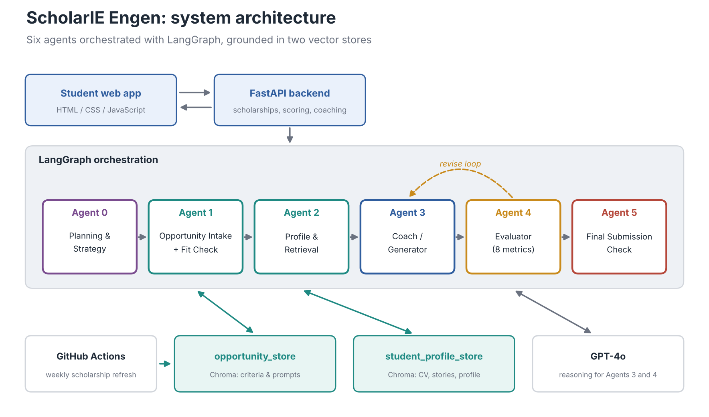

<!-- Replace the existing ScholarlE Engen entry under "Featured Projects" in the portfolio's index.md with this. -->

### [ScholarlE Engen: AI scholarship coach](scholarle-engen.html)
*Technical Project Lead, AI co-implementer and Data manager | System Innovations, Rice SEIP 2026*

- Led cross-functional delivery of a six-agent AI coaching platform (LangGraph, FastAPI, Chroma, GPT-4o) that guides students through scholarship applications without writing the essay for them.
- Designed an eight-metric, research-grounded essay scoring rubric and a rule-based compliance agent.
- Built the profile and story question sets and a self-updating scholarship wiki.

[Read the case study](scholarle-engen.html)
