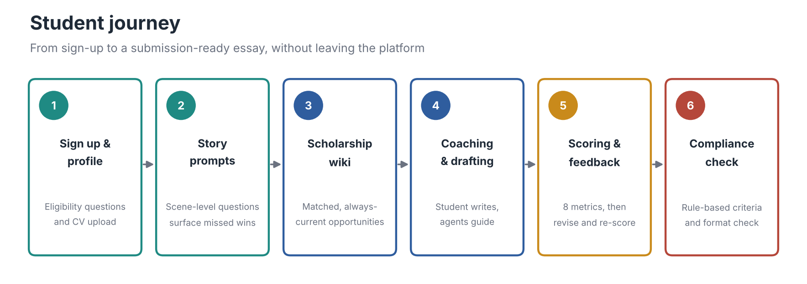
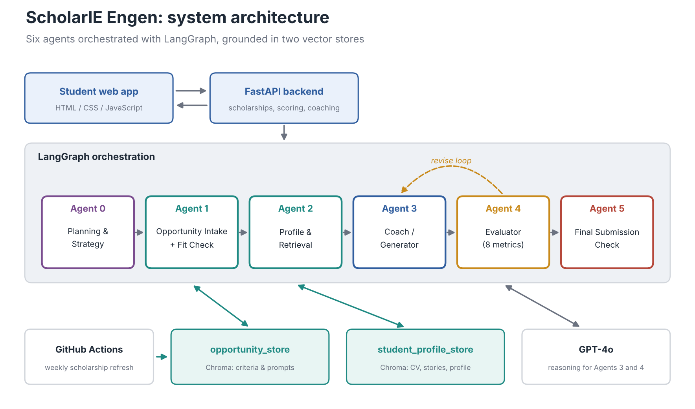
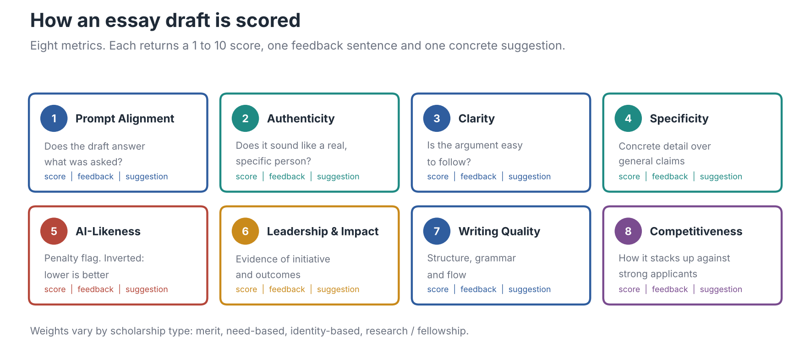
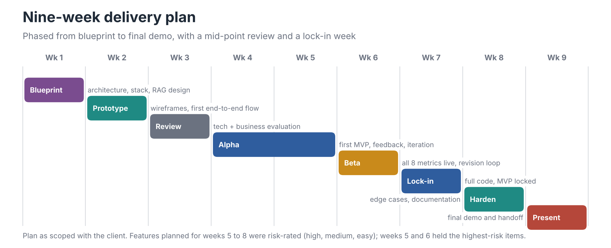

[Back to portfolio](./)

# ScholarlE Engen: an AI scholarship coach

A multi-agent platform that helps students write stronger scholarship applications in their own voice, built for a System Innovations client through Rice University's SEIP program.

| | |
|---|---|
| **Domain** | EdTech, applied AI |
| **Client** | System Innovations (Rice SEIP, 2026) |
| **My roles** | Technical Project Lead, AI co-implementer, Data manager |
| **Stack** | Python, LangGraph, FastAPI, Chroma, OpenAI GPT-4o, HTML / CSS / JavaScript, GitHub Actions |
| **Team** | Five people: team lead, project / technical lead (me), AI engineer, software engineer, technical support |
| **Code** | Client codebase is private. [Project overview](https://github.com/akshattripathi26/SEIP_2026) |

## The business problem

Students miss scholarships they qualify for. Opportunities are scattered, eligibility rules are hard to read, and students with thin CVs do not know which of their experiences matter. Generic AI writing tools add a new risk: polished essays that read as machine written.

## The approach

The client wanted a coach, not a ghostwriter. We built a six-agent pipeline where the student writes every word and the system asks, grounds and scores.

- **Agents 0 to 2** plan the workflow, check the student fits the scholarship and retrieve the relevant parts of the student's profile.
- **Agent 3** coaches with questions and structure.
- **Agent 4** scores the draft, and the student revises in a loop.
- **Agent 5** runs a rule-based compliance check on word count, format, required documents and eligibility.

Two separate Chroma vector stores keep student data apart from scholarship data.

## Scoring: eight metrics, grounded in research

I designed the rubric from three papers: Cornell's study of 30,000 human and LLM essays (LLMs over-use prompt keywords and are easy to detect), a U Tokyo study showing iterative rubric refinement improves agreement with human graders, and a 65-study review showing LLM-human agreement is best with criteria-based prompts that require justification. That is why every metric returns a score, a one-sentence justification and one suggestion, and why AI-Likeness acts as a penalty flag.

## Getting better inputs from students

- A ~38-question profile built to **unlock eligibility** (Pell status, first-generation, citizenship, county, military connection), in required, optional and optional-sensitive tiers.
- **Scene-level story prompts** that surface achievements students leave off their CV, structured so answers can feed the essay.

## Keeping scholarships current without sending students away

A weekly GitHub Actions job runs a GPT-4o web-search discovery agent, validates each link, and writes results to the platform database behind a `/scholarships` endpoint. Students stay on the platform and never have to log in to third-party aggregators.

## How the project was run

- **Scope control.** The MVP was narrowed to scholarships and fellowships. College applications and internships were deferred.
- **Build on what existed.** We extended a client-provided proof-of-concept pipeline, turning its proposal state into an `ApplicationState`, and locked that schema in week 1 so every node was written against the same contract.
- **Risk first.** A 15-item risk assessment fed a Gantt chart where features were rated high, medium or easy risk. Weeks 5 and 6 held the riskiest items, so they were discussed earliest.
- **Team discipline.** One private repository, a branch per engineer, pull requests before merging, weekly release tags proposed as restore points, and a weekly Thursday client meeting.

## What changed because of client feedback

After the client reviewed the workflow and user story map, we added Agent 0 for onboarding, discovery strategy, a pipeline tracker and deadline reminders, an eligibility fit check inside Agent 1, richer profile fields, a final grammar review, and Agent 5 for final submission checks. The story map grew to seven columns. Resume generation stayed on the "under consideration" list.

## Engineering problems I solved

- **A codebase that would not run.** Unresolved Git merge conflicts ran through eight files. I reconciled them, rebuilt a working pipeline and verified no conflict markers remained.
- **From one score to eight.** I adapted a single-score node into an eight-metric scorer that returns structured JSON per metric, with a "cite or omit" rule so feedback never invents facts about the student.
- **A compliance agent that is rules, not vibes.** Keyword, word-count, format and document checks, with specific guidance on what to fix and a route back to drafting.
- **A wiki that does not go stale.** The weekly discovery agent validates every URL before saving, as a guard against hallucinated links.

## Calibration and usability

I wrote sample essays against real scholarship prompts to test the scoring engine, and reviewed the landing page with specific fixes (larger "0 essays written for you" stat, plainer wording, social proof, pricing clarity). A customer interview led to a set of tutorial ideas now queued for the team: an onboarding checklist, a score explainer overlay so students do not misread AI-Likeness, a sample-student demo and inline coach messages.

## My contribution

- Led sprint planning and client communication and delivered the charter, risk assessment, user story map and Gantt chart.
- Designed the profile and story question sets and the scoring rubric.
- Built the compliance agent, adapted the scoring node and repaired a merge-conflicted codebase so it ran again.
- Designed the scholarship auto-update pipeline and knowledge base.
- Wrote test essays to calibrate the scoring engine.

## Outcomes

*Add verified results here before publishing: demo date, scholarships in the wiki, essays scored, client feedback you may quote.*

## Limitations

Scoring is advisory. LLM-human agreement is strong but not perfect, so scores are meant to guide revision, not predict awards. Client code and data are private.

[Back to portfolio](./)
