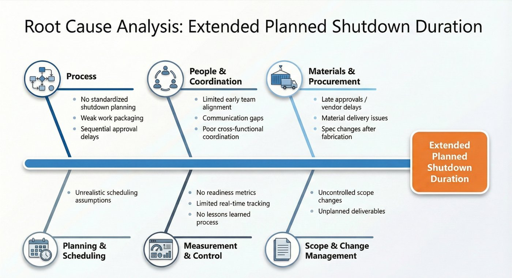
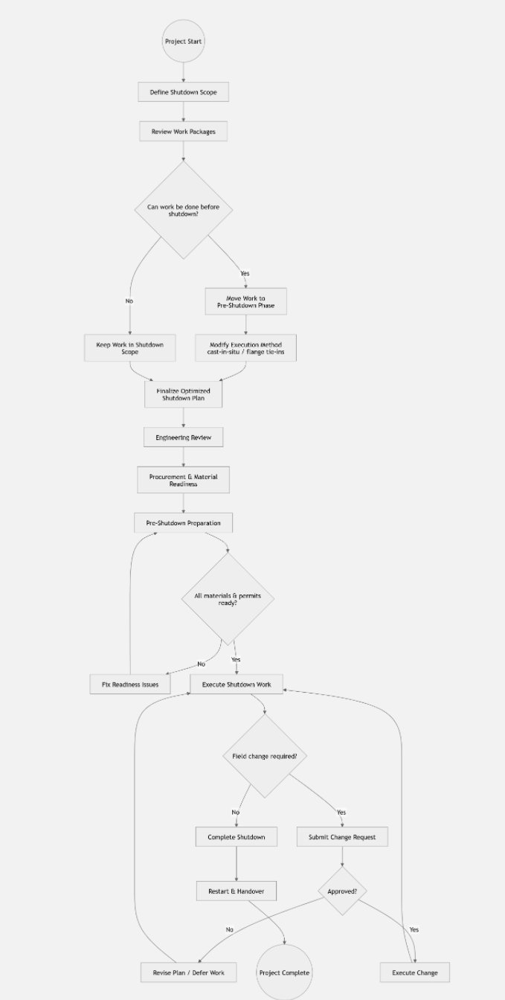

[← Back to portfolio](./)

# Reducing Planned Shutdown Duration in Oil & Gas Construction

**A Lean Six Sigma (DMAIC) project: cut planned shutdowns roughly in half by moving work out of the shutdown window instead of trying to compress it.**

| | |
|---|---|
| **Domain** | Industrial engineering · Lean Six Sigma · Project and construction management |
| **Methods** | Project charter, process mapping, fishbone root-cause analysis, solution design, control plan |
| **Team** | Group A: Akshat Tripathi, Dauletkhan Meshitbayev (subject-matter expert), Willy Lema, Nurym Kussaiyn (coordinator) |
| **Context** | Rice University, Lean Six Sigma course project |

## Target outcomes

| Shutdown duration | Pre-shutdown completion | Rework during shutdown |
|:---:|:---:|:---:|
| **~6 → ~3 months** | **≥75%** (currently not standardized) | **≥50% reduction** |

*These are targets set by the project, not measured results.*

---

## Define: the problem

Planned shutdowns in oil and gas construction can run **up to 6 months**, causing production losses and high cost. The root issue is that **too much work is executed during the shutdown window**, including activities that could be completed beforehand.

- **Sponsor:** Director of Operations
- **Stakeholders:** Operations, Finance, Program Management, Engineering, Procurement, Construction
- **KPIs:** critical-path delay, shutdown duration, rework rate, overrun cost, quality non-conformance rate

## Measure: the gap

About 60% of foundation work, 70% of piping, and 50% of electrical scope is currently executed inside the shutdown window. The targets bring those shares down to ≤20%, ≤30%, and ≤25%.

## Analyze: root causes

The delay is **systemic, not just operational**. Causes cluster across six categories: process, people and coordination, materials and procurement, planning and scheduling, measurement and control, and scope and change management.

## Improve: three solution pillars

| 1. Scope optimization | 2. Execution method improvement | 3. Planning & readiness |
|---|---|---|
| Identify non-critical activities | Foundations: cast-in-situ / pre-installed anchors | Faster RFI and submittal turnaround |
| Shift that work to the pre-shutdown phase | Piping: flange tie-ins, prefabricated spools | Material and equipment readiness |
| Keep only critical-path work in the shutdown | Electrical: trays, routing, modular assemblies prepared in advance | Stronger engineering-procurement-construction (EPC) coordination |
| Enforce strict change control and lock scope | | Permits, approvals, and site readiness verified before shutdown |

**Redesigned process.** Every work package passes a "can this be done before shutdown?" decision. A readiness gate blocks the shutdown start until materials and permits are confirmed.

View the future-state process map

**Implementation roadmap**
- **Pre-shutdown:** engineering review, procurement, material readiness, work packaging, foundations, trays, supports, prefabrication
- **Shutdown window:** critical-path work only, live tie-ins, final connections, controlled field changes
- **Restart & handover:** testing, closeout, deferred-work list, lessons learned

## Control: keeping the gains

| Metric | Owner | Cadence | Trigger / action |
|---|---|---|---|
| Shutdown duration | Project Manager | Weekly | Escalate if the forecast exceeds target |
| Pre-shutdown completion rate | Construction / Operations | Weekly | Block shutdown start until the readiness threshold is met |
| Critical shutdown activities | Engineering | Stage-gate | Approve only critical-path work inside the shutdown |
| Rework during shutdown | QA / Construction | Daily | Root cause and corrective action within 24 hours |
| Material / permit readiness | Procurement / PM | Weekly | Resolve shortages before shutdown start |

## Takeaway

Reduce shutdown time by **moving non-critical work out of the shutdown window**, rather than trying to compress everything inside it. This protects the critical path, lowers cost, and makes the schedule more predictable.

[← Back to portfolio](./)
